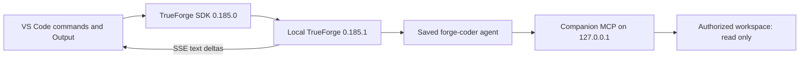

# ForgePilot — Phase 2

A VS Code inline-editing agent powered by an existing **TrueForge saved agent**. The extension creates named sessions, sends turns through `@truefoundry/trueforge-sdk`, renders actual streamed text in the **ForgePilot** Output panel, and owns an authenticated local MCP workspace server. All model execution and tool orchestration run in TrueForge.

Phase 1 read-only sessions retain `list_files`, `read_file`, and `search_workspace`. Phase 2 adds an opt-in `propose_patch` MCP tool, genuine TrueForge staging approval, native VS Code hunk review, approved buffer edits, cancellation and guarded undo. Terminal execution and autonomous multi-file modification remain outside this phase.

## Inline editing

1. Open a trusted local workspace, save the file, and select the code to modify.
2. Press **Ctrl+Alt+I** (**Cmd+Alt+I** on macOS), or run **ForgePilot: Edit Selection**, and enter the instruction.
3. Watch streamed text in **ForgePilot** Output. Choose **Allow Staging** when TrueForge requests tool approval. This grants permission to produce a proposal; it does not apply changes.
4. Review the native original/proposed diff. In Explorer → **ForgePilot Patch Review**, select each hunk to jump to its diff and use its check/cross actions. The row shows pending, accepted or rejected. **Ctrl+Alt+R** opens keyboard review. Accept All and Reject All are available in the view toolbar and Command Palette.
5. Run **ForgePilot: Apply Accepted Hunks** after reviewing every hunk. Only accepted hunks enter the editor buffer; save normally to write them to disk.
6. Use **ForgePilot: Undo Last Accepted Edit** to restore exactly the previous content. Undo refuses if the document or file has changed subsequently. **ForgePilot: Cancel Turn** invalidates pending proposals and requests SDK cancellation for an active turn.

Start with saved UTF-8 text files up to 64 KiB. Edits are confined to the selected region of one file. Proposals are ephemeral; close/reopen, external modifications or document version changes require a new proposal. Read-only and proposal sessions share the same saved agent, so run live verification commands sequentially.

See [Phase 2 verification](docs/phase-2-verification.md) for actual live sessions, automated host results, Flask Task A, manual checks and limits. Automated approval drivers do not verify physical keypresses or warning-button clicks.

## Install and start

Prerequisites: Node.js **22.14+** (22 or 24 recommended), npm, desktop VS Code **1.101+**, and TrueForge **0.185.1** on the same host as the extension host. VS Code 1.101 introduced a Node 22 extension host. Tested on Linux with Node 26.7.0 and VS Code 1.117.0. SDK **0.185.0** is the SDK shipped by TrueForge 0.185.1; their version numbers intentionally differ.

```sh
npm ci
npm run build
npm run lint
npm test
```

In a separate terminal, start TrueForge with the **exact-host loopback exception** required by its outbound URL guard:

```sh
OUTBOUND_URL_ALLOWED_HOSTS='["127.0.0.1"]' npx @truefoundry/trueforge@0.185.1 --port 8790
```

If TrueForge is already running without that setting, stop it gracefully and restart it with the command above. Setting this variable on the extension or test process does not change TrueForge's running configuration. Preserve any existing allowlisted hosts when adding `127.0.0.1`. Keep the outbound guard enabled.

1. Open <http://localhost:8790>. Configure your model provider and its credential in **Settings → Models**, within TrueForge. The verified model was `google-gemini/gemini-3-1-flash-lite`, displayed as Gemini 3.1 Flash Lite. ForgePilot contains no model provider client.
2. Keep the existing saved `forge-coder` agent. For a clean installation, run `npm run setup:agent` to create it from [config/forge-coder.agent.json](config/forge-coder.agent.json). This command preserves an existing agent. The JSON uses SDK **camelCase** fields; do not paste it unchanged into the REST API, whose wire fields use snake_case. The example model can be replaced with any model configured in TrueForge.
3. In the saved agent, explicitly disable sandbox, dynamic subagents, web search, memory, and generative UI. Use no skills or other MCP connectors. These restrictions are checked before session creation and before every turn. The checked-in agent definition meets them. Do not edit or run this dedicated agent from another client while ForgePilot is using it.
4. Open this repository in VS Code and press **F5**, selecting **ForgePilot: Extension Development Host**. In the new window, open the folder to authorize and trust it.
5. Run **ForgePilot: Start Read-Only Session** from the Command Palette, then **ForgePilot: Ask Agent**. Try: `Use list_files to discover this project, then read_file to inspect README.md. Explain what it contains.`
6. Watch **View → Output → ForgePilot**. Metadata-only JSON logs are in **ForgePilot Logs**. Use **ForgePilot: Cancel Turn** or the progress notification's Cancel button to interrupt. Use **ForgePilot: Stop Session and MCP Server** when done.

For multi-root workspaces, the extension prompts you to authorize exactly one folder. Untrusted and virtual workspaces are unsupported. Folder changes stop the session. Remote VS Code hosts require TrueForge to run on that same remote host; your desktop's `localhost` is not the remote host's loopback.

## Architecture



`Bridge` registers a temporary connector with `client.settings.mcpServers.create`, verifies tool discovery through TrueForge, and attaches exactly the three tool names to the saved agent with `client.agents.update`. It then calls:

```ts
const { data: session } = await client.sessions.create({
  agent: { name: 'forge-coder' },
});
const stream = await client.sessions.createTurnStream(session.id, {
  input: [{ type: 'user.message', content: instruction }],
});
for await (const event of stream) {
  if (event.type === 'model.message.delta') output.append(event.content ?? '');
}
```

The SDK decodes wire fields into camelCase. `model.message.delta` carries streamed text; completed `model.message` records with `toolCalls`, and correlated `tool.response` records, are available from `client.sessions.listEvents`. A successful HTTP connection alone does not establish model or tool execution.

There is no custom agent loop. TrueForge chooses tool calls, invokes MCP, calls the model, and persists sessions. The companion uses MCP **stateless Streamable HTTP**, which the installed TrueForge transport client supports. Its JSON tool responses are separate from TrueForge's genuine SSE model streaming.

The companion is a single child process with no descendants. It receives a random 256-bit token and root over IPC, inherits no provider keys, and binds a random port only on `127.0.0.1`. Requests need the token, the exact Host header, and no Origin header. No CORS is enabled. TrueForge stores the temporary header credential in its connector settings; it is never written into this repository or logged. Explicit stop sends SIGTERM, waits for exit, and escalates to SIGKILL if needed. Losing parent IPC also closes the companion. The extension uses Electron's Node mode when it forks inside VS Code.

On stop, ForgePilot cancels any active backend turn, removes only its own agent attachment, deletes its connector, and stops the child. Sessions and tool history remain in TrueForge. Failed backend cancellation immediately closes the companion to revoke workspace access. Registry cleanup failure is reported with the exact connector name. Hard termination can leave a stale registry entry, though the process closes on IPC loss: remove that `forgepilot-…` entry from the agent first, then from **Settings → Connectors**, before starting again.

The saved-agent API replaces the manifest and has no conditional update mechanism. ForgePilot re-reads before attachment and cleanup to preserve unrelated fields, but **one active ForgePilot instance per saved agent** is supported. Other attached connectors are rejected; concurrent edits to that agent must be avoided. Read-only turns still reject interactive requests. Inline turns handle only exact `propose_patch` approval requests through the genuine SDK `sessions.createTurnEvents` API; other interactive requests cancel safely. The agent has no apply, approve, shell or write tool.

## Workspace policy and budgets

All tool paths are relative to the canonical authorized root. Absolute paths, `..`, ambiguous separators, NULs, drive/stream syntax, hidden paths (including `.env`, `.git`, `.ssh`, `.aws`, and `.npmrc`), common credential/key names and extensions, and generated/dependency directories are rejected. Directory and file symlinks are never followed, including links pointing inside the root. Hardlinked files, non-regular files, binary/NUL-containing files, and invalid UTF-8 are rejected. Reads use read-only descriptors, no-follow/nonblocking flags where available, identity checks before/after opening, and Linux `/proc/self/fd` containment checks on the opened descriptor. Directory enumeration revalidates each path; no workspace filesystem write APIs are exposed.

| Budget | Limit |
| --- | --- |
| One file | 64 KiB, UTF-8 |
| One serialized tool response | 96 KiB |
| Traversal | 4,000 entries, depth 12, up to 200 files |
| Traversal / search time | 3 seconds each, checked between filesystem operations |
| Search input | Single-line, case-sensitive literal, 1–200 characters |
| Search work | Up to 4 MiB of readable files |
| Search output | 100 matches; 500 characters per line excerpt |
| MCP HTTP | 16 KiB request body; 8 active requests; 16 connections |
| Prompt / turn | 16,000 characters; 180 seconds by default, configurable 10–600 |

Listings and searches report `truncated`; searches also report `skippedFiles`. `list_files` returns file paths recursively, not a complete unbounded tree. Search is literal rather than regex to avoid unbounded regex work. The deny policy is conservative and independent of `.gitignore`; it deliberately hides all dotfiles. Filename rules cannot identify a credential embedded in an otherwise ordinary source file. Authorize only a project suitable for your configured model provider. Linux descriptor checks were tested; Windows and macOS behavior remains unverified.

## Configuration and debugging

Settings are machine scoped to keep a repository from redirecting TrueForge connections:

| Setting | Default |
| --- | --- |
| `forgepilot.baseUrl` | `http://localhost:8790` (loopback HTTP only) |
| `forgepilot.agentName` | `forge-coder` |
| `forgepilot.turnTimeoutSeconds` | `180` |

For optional TrueForge OIDC authentication, run **ForgePilot: Set TrueForge Authentication Token**. It stores the token in VS Code `SecretStorage`; an empty value removes it. Model API keys belong in TrueForge, not this command. CLI scripts accept optional `TRUEFORGE_TOKEN`, `TRUEFORGE_BASE_URL`, and `TRUEFORGE_AGENT_NAME` (the last is used by live verification). Restart the ForgePilot session after changing settings or tokens. See [config/trueforge.env.example](config/trueforge.env.example).

`npm run watch` rebuilds bundles while developing; `npm run build` also type-checks. F5 has a build task and source maps. You can also launch manually:

```sh
code --new-window --extensionDevelopmentPath="$PWD" /absolute/path/to/workspace
```

The `forgepilot.ask` command accepts an optional string argument for editor automation; without it the command opens an input box. Both paths use the same session, SDK streaming, safety checks, and companion.

Errors include missing agents, unsafe agent settings, failed connector discovery, blocked loopback URLs, backend failures, paused turns, missing terminal events, and deadlines. Raw SDK error bodies, prompts, file contents, and credentials are excluded from structured logs. Assistant output is visible in the normal Output channel. Turn creation and registry mutations have SDK retries disabled to avoid duplicate operations after ambiguous failures. Recreate a session after a failed startup; inspect the saved session before retrying an interrupted turn.

## Verification

```sh
npm ci
npm run check                 # compile, lint, all automated tests; no model required
npm run test:unit
npm run test:integration      # real loopback MCP + explicitly labelled SDK HTTP contract fixtures
npm run test:live             # real saved agent, real model, MCP calls, persisted history, hashes
VSCODE_EXECUTABLE_PATH=/opt/visual-studio-code/code npm run test:extension
FORGEPILOT_EXTENSION_LIVE=1 VSCODE_EXECUTABLE_PATH=/opt/visual-studio-code/code npm run test:extension
```

Use your platform's actual VS Code executable for `VSCODE_EXECUTABLE_PATH`; omit it to let `@vscode/test-electron` download a test installation. A working graphical display (or Xvfb on Linux) is needed. The default host test activates the real extension and checks command registration; `FORGEPILOT_EXTENSION_LIVE=1` additionally drives the production start/ask/stop commands against the real local saved agent and checks persisted MCP file contents. It currently targets the default local URL and `forge-coder` agent.

Live verification uses disposable temporary fixtures, including an unpredictable file marker. It requires both actual companion tool logs and correlated persisted MCP history; there is no mock model fallback. It compares SHA-256 file snapshots before/after and leaves the TrueForge session for inspection. Results are written to ignored `artifacts/live-verification.json`. The GUI test uses a disposable profile and workspace. These checks can incur your configured provider's normal charges.

See [docs/phase-1-verification.md](docs/phase-1-verification.md) for the measured acceptance results, changed files, and remaining limitations.

## Sources and attribution

- [Official competition specification](https://techfest.org/media/compiProbStatement/TrueFoundry_Forge-a-thon_compressed_UvvRJ9C.pdf): reviewed for architecture and scope; Phase 1 is not a complete competition submission.
- [TrueForge SDK quickstart](https://trueforge.dev/api/quickstart), [saved agent and event recipes](https://trueforge.dev/api/use-agent), [MCP setup](https://trueforge.dev/mcp-servers), and [SDK source](https://github.com/truefoundry/trueforge/tree/main/packages/trueforge-sdk): API signatures checked against locally installed server 0.185.1 and SDK 0.185.0 declarations and serializers.
- [TrueForge outbound guard configuration](https://github.com/truefoundry/trueforge/blob/main/charts/trueforge/README.md): narrow host allowlist also verified in installed `dist/main.js` and `trueforge-core/dist/core/util/ssrfGuard.js`.
- [MCP TypeScript SDK](https://github.com/modelcontextprotocol/typescript-sdk/tree/v1.x) and [VS Code extension documentation](https://code.visualstudio.com/api/get-started/your-first-extension).
- [VS Code 1.101 release notes](https://code.visualstudio.com/updates/v1_101): confirms the Node 22 extension runtime required by the declared minimum editor version.

Starting point: **from scratch**, on repository commit `e77080b` (initial README, ignore file and MIT license). No editor project was forked, and the existing MIT [LICENSE](LICENSE) is preserved. Built with Codex assistance. Verified model execution ran through local TrueForge to Google's configured Gemini provider; TrueForge did not return cost estimates for these sessions, so no cost is asserted.
