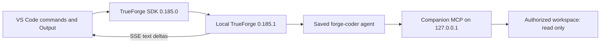

# ForgePilot — Safe editing and model resilience

For local installation use the **CLI wrapper** (`code --install-extension ./artifacts/forgepilot.vsix --force`, or `/opt/visual-studio-code/bin/code` on this machine). `VSCODE_EXECUTABLE_PATH=/opt/visual-studio-code/code` identifies the Electron executable for test-host launching; it is not the installation CLI. Host tests compare both loaded bundle hashes against the current build, so an older installed version cannot pass merely by exposing the same commands.

**Verification status:** Phase 3 has verified review-assisted, multi-turn Task B acceptance (six batches, 22 hunk decisions); Phase 4 has verified Task C and model resilience. Phase 5 results are in [final verification](docs/phase-5-final-verification.md); physical GUI acceptance remains required. Task B is reproducible without inference using the [archived accepted patch and replay instructions](docs/evidence/task-b/README.md). This does not establish unassisted single-turn reliability.

| Phase | Current status |
| --- | --- |
| 1 | PASS — read-only TrueForge/MCP integration |
| 2 / 2.1 | PASS — inline review, guarded application/undo and hardening |
| 3 | PASS — verified multi-turn Task B acceptance |
| 4 | PASS — verified Task C and resilience |
| 5 | CONDITIONAL — automated/replay gates pass; physical GUI checks pending |
| 6 | PENDING — demo, write-up and submission preparation |

A VS Code inline-editing agent powered by an existing **TrueForge saved agent**. The extension snapshots saved agents into isolated TrueForge sessions, sends turns through `@truefoundry/trueforge-sdk`, renders actual streamed text in the **ForgePilot** Output panel, and owns an authenticated local MCP workspace server. All model execution and tool orchestration run in TrueForge.

Phase 1 read-only sessions retain `list_files`, `read_file`, and `search_workspace`. Phase 2 adds an opt-in `propose_patch` MCP tool, genuine TrueForge staging approval, native VS Code hunk review, approved buffer edits, cancellation and guarded undo. Phase 3 adds autonomous discovery and approved multi-file batches. Agent-accessible terminal execution remains outside this phase.

## Autonomous multi-file editing

Run **ForgePilot: Autonomous Agent** (Ctrl+Alt+A / Cmd+Alt+A) and describe the feature without naming files. TrueForge drives repository discovery, context retrieval, planning and one final proposal batch. The read-only `check_batch` tool lets the agent validate and correct its own draft before requesting approval. Observe streamed responses and actual tool activity in ForgePilot Output. **ForgePilot: Inspect Repository Context** opens a native read-only inspector with real candidate ranks, selected snippets, reasons, budget estimates and tool-call IDs.

Optional references use `@file:src/example.py`, `@symbol:SomeClass`, `@file(src/example.py)` or `@symbol(SomeClass)`. `@src/example.py` and `@SomeClass` are shorthand. References follow the same path/encoding/link policy as automatic retrieval.

Choose **Allow Batch Staging** for TrueForge's proposal tool request. This only stages validated proposals. Explorer → **ForgePilot Agent Changes** groups changes by file; select a file/hunk for its native diff. Check/cross actions accept/reject a file or individual hunk. Toolbar commands accept/reject remaining hunks without overriding earlier decisions. **Review Batch Hunks** supports keyboard Quick Picks. Review every hunk, then **Apply Accepted Batch Hunks**. Save normally. **Undo Last Accepted Batch** restores preceding contents and removes reviewed new files, while refusing unsafe restoration after unrelated changes.

**Cancel Turn** invalidates both pending inline and autonomous proposals and cancels an active SDK turn. **Open Verification Terminal** opens a normal VS Code terminal in the workspace; the agent has no shell capability. Run project tests there after saving approved edits. File creates are explicitly reviewed, never overwrite an existing target, and require an existing parent directory.

Autonomous generation uses read-only `draft_file` validation for each file. `extend_draft` adds small disjoint edits without resending earlier edits; its new ID supersedes the old ID. Intentional complete replacement requires `replaceDraftId` and all edits. An ambiguous repeated submission returns `DRAFT_EXISTS` instead of dropping earlier changes. `list_drafts` recovers IDs, hashes and edit counts after compaction. Invalid corrections invalidate the affected draft. `check_drafts` revalidates the complete set, then `propose_drafts` requests genuine staging permission using short IDs. Exact anchors/hashes and every final file are revalidated; no fuzzy replacement occurs. Legacy `check_batch`/`propose_batch` remain supported.

For long files, `outline_file` supplies bounded declaration/heading locations for targeted reads. Isolated autonomous sessions retain generic protocol rules in their agent instructions and use TrueForge-owned compaction at 64,000 input tokens, without changing the saved agents. Start with the default 0–1,000 ms response pacing when capacity permits. If actual provider evidence shows a tighter input-token limit, configure `forgepilot.autonomousToolIntervalMs` deliberately; Task B recovery tested 5,000 ms against Gemini's reported 250,000 free-tier input tokens/minute. Pacing does not retry inference or guarantee provider capacity.

Live drivers default to **0 ms** response pacing; the recorded Task B recovery explicitly used 5,000 ms. The default retrieval budget is **12,000 estimated tokens**, configurable with `forgepilot.contextBudget`. Counts are `ceil(UTF-8 bytes / 3)`, include serialized retrieval metadata, and reserve instruction/output space. Packages stay below 20,000 characters for the installed TrueForge tool-response limit. This is a per-retrieval budget, not exact provider tokenization or a cumulative conversation limit. The inspector reports actual cumulative TrueForge terminal metrics separately when supplied. Source is ranked using lexical hits, declarations, paths, imports and implementation/test/documentation counterparts. Truncation and omissions are visible. Inventory, symbol and legacy schemas are deferred; context, range reads, search and retained-draft schemas are eager. There is no extension-owned model loop.

Run one live verification at a time against a saved agent. Provider quotas can fail a run; failed completion invalidates the entire pending batch. Failed editor operations attempt guarded restoration of recognized applied portions and report any unsafe/partial state. `WorkspaceEdit` is not a filesystem transaction or a public version CAS. Do not edit the same files concurrently during application. See [architecture](docs/architecture.md), [Phase 2.1 hardening](docs/phase-2-hardening.md) and [Phase 3 verification](docs/phase-3-verification.md).

## Provider failure and fallback

Fallback is disabled by default. To authorize it, set **user/machine** settings `forgepilot.fallbackEnabled: true` and `forgepilot.fallbackAgentName` to a distinct existing TrueForge saved agent. Verify that agent's model availability and normal usage terms first. For example, `forge-coder-openrouter` can be primary and the already configured `forge-coder` can be secondary. No model, payment method, key or endpoint is selected or changed automatically.

Only recognized provider/transport failures may switch agents, once per request. Invalid proposals, workspace conflicts, rejected approvals, user cancellation and an expired human approval wait do not. The failed generation is invalidated, backend cancellation requested, and its connector closed before a fresh session receives the original task. The saved agent definitions stay unchanged. Staging permission and hunk decisions must be given afresh. If both agents fail, a sanitized error identifies both failure categories, resources close, and another manual request remains available without restarting VS Code.

Cancel Turn and Stop work while a connection or fallback is preparing. Progress notifications close when operations settle; fallback uses a nonblocking information notification. Files already applied with explicit approval are governed by the existing guarded undo, never by automatic provider recovery. A transient stream failure cannot apply a partial proposal. There is no automatic retry of application, no recursive fallback, and no extension-owned LLM loop.

To reproduce official Task C, first prepare a **clean separate Flask checkout** at `22d924701a6ae2e4cd01e9a15bbaf3946094af65` with its test dependencies installed in a venv. Then run:

```sh
FORGEPILOT_FLASK_ROOT=/absolute/path/to/clean-flask \
FORGEPILOT_FLASK_PYTHON=/absolute/path/to/venv/bin/python \
VSCODE_EXECUTABLE_PATH=/opt/visual-studio-code/code npm run test:taskc
```

This explicit live test provisions and deletes **disposable** invalid-key and closed-port providers/agents, leaving real providers and both saved agent manifests unchanged. It makes genuine TrueForge inference through the configured `forge-coder` fallback, uses a disposable VS Code profile, checks native diffs/approvals, verifies Task A behavior and helper tests, and undoes the accepted change. Do not run it against a checkout with your own edits. Physical palette/modal clicks and the submission recording remain separate manual checks. See the [complete report](docs/phase-4-verification.md) for session identities, timings and limits. Task B was still incomplete when Phase 4 finished; the later Phase 3 recovery above has now passed executable acceptance.

## Inline editing

1. Open a trusted local workspace, save the file, and select the code to modify.
2. Press **Ctrl+Alt+I** (**Cmd+Alt+I** on macOS), or run **ForgePilot: Edit Selection**, and enter the instruction.
3. Watch streamed text in **ForgePilot** Output. Choose **Allow Staging** when TrueForge requests tool approval. This grants permission to produce a proposal; it does not apply changes.
4. Review the native original/proposed diff. In Explorer → **ForgePilot Patch Review**, select each hunk to jump to its diff and use its check/cross actions. The row shows pending, accepted or rejected. **Ctrl+Alt+R** opens keyboard review. Accept All and Reject All are available in the view toolbar and Command Palette.
5. Run **ForgePilot: Apply Accepted Hunks** after reviewing every hunk. Only accepted hunks enter the editor buffer; save normally to write them to disk.
6. Use **ForgePilot: Undo Last Accepted Edit** to restore exactly the previous content. Undo refuses if the document or file has changed subsequently. **ForgePilot: Cancel Turn** invalidates pending proposals and requests SDK cancellation for an active turn.

Start with saved UTF-8 text files up to 64 KiB. Edits are confined to the selected region of one file. Proposals are ephemeral; close/reopen, external modifications or document version changes require a new proposal. The editor snapshots the selected saved agent without changing its manifest. Legacy standalone verification scripts still attach to saved agents; run those sequentially.

See [Phase 2 verification](docs/phase-2-verification.md) for actual live sessions, automated host results, Flask Task A, manual checks and limits. Automated approval drivers do not verify physical keypresses or warning-button clicks.

## Install and start

Prerequisites: Node.js **22.14+** (22 or 24 recommended), npm, desktop VS Code **1.101+**, and TrueForge **0.185.1** on the same host as the extension host. VS Code 1.101 introduced a Node 22 extension host. Strict checks passed on Linux with Node 22.23.5, 24.22.3 and 26.7.0; actual host tests used VS Code 1.117.0. SDK **0.185.0** is the SDK shipped by TrueForge 0.185.1; their version numbers intentionally differ.

```sh
npm ci
npm run build
npm run lint
npm test
```

Opening this repository in an ordinary VS Code window does **not** install the extension. Choose either:

- **Development:** open this repository and press F5, choosing **ForgePilot: Extension Development Host**. Use ForgePilot commands in the **new Development Host window**. The launch task builds the current sources first.
- **Local installation:** run `npm run package:extension`, then `code --install-extension ./artifacts/forgepilot.vsix --force`, then **Developer: Reload Window** in the intended normal VS Code profile. Packaging builds via `vscode:prepublish`; it does not publish anything. Use your actual VS Code CLI path if `code` points to another installation.

Confirm `code --list-extensions --show-versions` contains `nipunkalsotra.forgepilot@0.1.0`. Trust the local workspace and search the Command Palette for **ForgePilot:**. Titles include **Start Read-Only Session**, **Stop Session and MCP Server**, **Autonomous Agent**, **Inspect Repository Context**, **Apply Accepted Batch Hunks**, and **Undo Last Accepted Batch**. Check **Developer: Show Running Extensions** and **ForgePilot Logs** if activation fails. The host regression checks every contributed command and command-triggered activation; physical clicks are a separate manual check.

To use the configured OpenRouter agent, set the machine-scoped `forgepilot.agentName` to `forge-coder-openrouter`, then stop/start the session. Its actual registered model is `openrouter/nemotron-3-ultra-free`; credentials and endpoints stay in TrueForge. The original `forge-coder` agent is preserved. `node --import tsx scripts/setup-openrouter.ts` validates the existing registered model and installs generic retained-draft instructions/security settings on the OpenRouter agent only; it never creates a provider or changes credentials. Its checked-in definition is `config/forge-coder-openrouter.agent.json`. `config/forge-coder-gemini-high.agent.json` is a credential-free example for the same already registered Gemini model with high reasoning. The acceptance run used disposable copies and deleted them afterward; original Gemini/OpenRouter agents were preserved. Importing that example is an explicit developer choice, not automatic model selection or a quota guarantee.

For isolated host verification, set `TRUEFORGE_AGENT_NAME=forge-coder-openrouter`; the test driver selects it inside the disposable VS Code profile. `FORGEPILOT_AUTONOMOUS_LIVE=1` enables the genuine three-file fixture; `FORGEPILOT_PHASE3_FLASK=1` enables pinned Flask Task B with `FORGEPILOT_FLASK_ROOT` and `FORGEPILOT_FLASK_PYTHON`. These checks make real TrueForge requests. See [recovery evidence](docs/phase-3-recovery.md).

In a separate terminal, start TrueForge with the **exact-host loopback exception** required by its outbound URL guard:

```sh
OUTBOUND_URL_ALLOWED_HOSTS='["127.0.0.1"]' npx @truefoundry/trueforge@0.185.1 --port 8790
```

If TrueForge is already running without that setting, stop it gracefully and restart it with the command above. Setting this variable on the extension or test process does not change TrueForge's running configuration. Preserve any existing allowlisted hosts when adding `127.0.0.1`. Keep the outbound guard enabled.

1. Open <http://localhost:8790>. Configure your model provider and its credential in **Settings → Models**, within TrueForge. The verified model was `google-gemini/gemini-3-1-flash-lite`, displayed as Gemini 3.1 Flash Lite. ForgePilot contains no model provider client.
2. Keep the existing saved `forge-coder` agent. For a clean installation, run `npm run setup:agent` to create it from [config/forge-coder.agent.json](config/forge-coder.agent.json). This command preserves an existing agent. The JSON uses SDK **camelCase** fields; do not paste it unchanged into the REST API, whose wire fields use snake_case. The example model can be replaced with any model configured in TrueForge.
3. In the saved agent, explicitly disable sandbox, dynamic subagents, web search, memory, and generative UI. Use no skills or other MCP connectors. These restrictions are checked before session creation and before every turn. The checked-in agent definition meets them. Do not edit or run this dedicated agent from another client while ForgePilot is using it.
4. Open this repository in VS Code and press **F5**, selecting **ForgePilot: Extension Development Host**. In the new window, open the folder to authorize and trust it.
5. Run **ForgePilot: Start Read-Only Session** from the Command Palette, then **ForgePilot: Ask Agent**. Try: `Use list_files to discover this project, then read_file to inspect README.md. Explain what it contains.`
6. Watch **View → Output → ForgePilot**. Metadata-only JSON logs are in **ForgePilot Logs**. Use **ForgePilot: Cancel Turn** or the progress notification's Cancel button to interrupt. Use **ForgePilot: Stop Session and MCP Server** when done.

For multi-root workspaces, the extension prompts you to authorize exactly one folder. Untrusted and virtual workspaces are unsupported. Folder changes stop the session. Remote VS Code hosts require TrueForge to run on that same remote host; your desktop's `localhost` is not the remote host's loopback.

## Architecture



The editor registers a temporary connector with `client.settings.mcpServers.create`, verifies tool discovery through TrueForge, and snapshots the restricted saved agent into an isolated session using `client.sessions.create({ agent: { spec: ... } })`. Only the owned connector and its mode-specific tools are attached to that session; the saved agent is preserved. Turns use `client.sessions.createTurnStream(session.id, { input: [...] })`. Legacy standalone read-only/inline drivers temporarily attach to the saved agent, restore its attachment state on cleanup, and must run sequentially. See [architecture](docs/architecture.md) for approval correlation and session isolation.

The SDK decodes wire fields into camelCase. `model.message.delta` carries streamed text; completed `model.message` records with `toolCalls`, and correlated `tool.response` records, are available from `client.sessions.listEvents`. A successful HTTP connection alone does not establish model or tool execution.

There is no custom agent loop. TrueForge chooses tool calls, invokes MCP, calls the model, and persists sessions. The companion uses MCP **stateless Streamable HTTP**, which the installed TrueForge transport client supports. Its JSON tool responses are separate from TrueForge's genuine SSE model streaming.

The companion owns bounded Git metadata subprocesses only in autonomous inventory; these are tracked and killed during companion cleanup. Read-only and inline tools spawn no descendants. It receives a random 256-bit token and root over IPC, inherits no provider keys, and binds a random port only on `127.0.0.1`. Requests need the token, the exact Host header, and no Origin header. No CORS is enabled. TrueForge stores the temporary header credential in its connector settings; it is never written into this repository or logged. Explicit stop sends SIGTERM, waits for exit, and escalates to SIGKILL if needed. Losing parent IPC also closes the companion. The extension uses Electron's Node mode when it forks inside VS Code.

On stop, ForgePilot cancels any active backend turn, removes only its own agent attachment, deletes its connector, and stops the child. Sessions and tool history remain in TrueForge. Failed backend cancellation immediately closes the companion to revoke workspace access. Registry cleanup failure is reported with the exact connector name. Hard termination can leave a stale registry entry, though the process closes on IPC loss: remove that `forgepilot-…` entry from the agent first, then from **Settings → Connectors**, before starting again.

The saved-agent API replaces the manifest and has no conditional update mechanism. ForgePilot re-reads before attachment and cleanup to preserve unrelated fields, but **one active ForgePilot instance per saved agent** is supported. Other attached connectors are rejected; concurrent edits to that agent must be avoided. Read-only turns still reject interactive requests. Inline turns handle only exact `propose_patch` approval requests; autonomous turns correlate `propose_batch` and supported native question responses through the genuine SDK `sessions.createTurnEvents` API; other interactive requests cancel safely. The agent has no apply, approve, shell or write tool.

## Workspace policy and budgets

The following table preserves the original read-only limits. Autonomous tools add a 10,000-file inventory (Git tracked/untracked excluding ignored paths, or bounded fallback: 30,000 entries, depth 20), 5-second inventory/search checks, an 8 MiB lexical scan ceiling, reads of at most 200 lines from UTF-8 files up to 1 MiB, and at most 12 proposals of 64 KiB each. A batch input is limited to 90,000 serialized bytes. Autonomous HTTP bodies are capped at 1 MiB; the original read-only/proposal limits remain in effect for their modes. Limits are cooperative checks between I/O operations, not hard real-time filesystem deadlines.

All tool paths are relative to the canonical authorized root. Absolute paths, `..`, ambiguous separators, NULs, drive/stream syntax, hidden paths (including `.env`, `.git`, `.ssh`, `.aws`, and `.npmrc`), common credential/key names and extensions, and generated/dependency directories are rejected. Directory and file symlinks are never followed, including links pointing inside the root. Hardlinked files, non-regular files, binary/NUL-containing files, and invalid UTF-8 are rejected. Reads use read-only descriptors, no-follow/nonblocking flags where available, identity checks before/after opening, and Linux `/proc/self/fd` containment checks on the opened descriptor. Directory enumeration revalidates each path; no workspace filesystem write APIs are exposed.

| Budget | Limit |
| --- | --- |
| One file | 64 KiB, UTF-8 |
| One serialized tool response | 96 KiB |
| Traversal | 4,000 entries, depth 12, up to 200 files |
| Traversal / search time | 3 seconds each, checked between filesystem operations |
| Search input | Single-line, case-sensitive literal, 1–200 characters |
| Search work | Up to 4 MiB of readable files |
| Search output | 100 matches; 500 characters per line excerpt |
| MCP HTTP | 16 KiB request body; 8 active requests; 16 connections |
| Prompt / turn | 16,000 characters; 180 seconds by default, configurable 10–600 |

Listings and searches report `truncated`; searches also report `skippedFiles`. `list_files` returns file paths recursively, not a complete unbounded tree. Search is literal rather than regex to avoid unbounded regex work. The deny policy is conservative and independent of `.gitignore`; it deliberately hides all dotfiles. Filename rules cannot identify a credential embedded in an otherwise ordinary source file. Authorize only a project suitable for your configured model provider. Linux descriptor checks were tested; Windows and macOS behavior remains unverified.

## Configuration and debugging

Settings are machine scoped to keep a repository from redirecting TrueForge connections:

| Setting | Default |
| --- | --- |
| `forgepilot.baseUrl` | `http://localhost:8790` (loopback HTTP only) |
| `forgepilot.agentName` | `forge-coder` |
| `forgepilot.fallbackEnabled` | `false` (machine scoped, explicit opt-in) |
| `forgepilot.fallbackAgentName` | empty (must name a distinct saved agent) |
| `forgepilot.turnTimeoutSeconds` | `180` (up to 600; useful for multi-file tasks) |
| `forgepilot.contextBudget` | `12000` estimated tokens (2,000–32,000) |
| `forgepilot.autonomousToolIntervalMs` | `0` (optional 0–10,000 ms response pacing for limited provider plans) |

For optional TrueForge OIDC authentication, run **ForgePilot: Set TrueForge Authentication Token**. It stores the token in VS Code `SecretStorage`; an empty value removes it. Model API keys belong in TrueForge, not this command. CLI scripts accept optional `TRUEFORGE_TOKEN`, `TRUEFORGE_BASE_URL`, and `TRUEFORGE_AGENT_NAME` (the last is used by live verification). Restart the ForgePilot session after changing settings or tokens. See [config/trueforge.env.example](config/trueforge.env.example).

`npm run watch` rebuilds bundles while developing; `npm run build` also type-checks. F5 has a build task and source maps. You can also launch manually:

```sh
code --new-window --extensionDevelopmentPath="$PWD" /absolute/path/to/workspace
```

The `forgepilot.ask` command accepts an optional string argument for editor automation; without it the command opens an input box. Both paths use TrueForge SDK streaming, safety checks, and an authorized companion. New requests get fresh execution state; an explicitly started unused session can serve the next request.

Errors include missing agents, unsafe agent settings, failed connector discovery, blocked loopback URLs, backend failures, paused turns, missing terminal events, and deadlines. Raw SDK error bodies, prompts, file contents, and credentials are excluded from structured logs. Assistant output is visible in the normal Output channel. Turn creation and registry mutations have SDK retries disabled to avoid duplicate operations after ambiguous failures. Recreate a session after a failed startup; inspect the saved session before retrying an interrupted turn.

## Verification

```sh
npm ci
npm run check                 # compile, lint, all automated tests; no model required
npm run test:unit
npm run test:integration      # real loopback MCP + explicitly labelled SDK HTTP contract fixtures
npm run test:live             # real saved agent, real model, MCP calls, persisted history, hashes
VSCODE_EXECUTABLE_PATH=/opt/visual-studio-code/code npm run test:extension
FORGEPILOT_EXTENSION_LIVE=1 VSCODE_EXECUTABLE_PATH=/opt/visual-studio-code/code npm run test:extension
```

Use your platform's actual VS Code executable for `VSCODE_EXECUTABLE_PATH`; omit it to let `@vscode/test-electron` download a test installation. A working graphical display (or Xvfb on Linux) is needed. Run GUI host suites sequentially so separate VS Code windows do not compete for editor focus. The default host test activates the real extension and tests actual inline and multi-file editor diff/application/undo APIs using labelled proposal fixtures; `FORGEPILOT_EXTENSION_LIVE=1` additionally drives production start/ask/stop against the real local saved agent and checks persisted MCP file contents. Tests default to the local URL and `forge-coder`; `TRUEFORGE_AGENT_NAME` selects a saved agent in the disposable profile. `FORGEPILOT_EXTENSION_PATH` can point at an installed VSIX's extension directory to check its actual bundle and contributions with the same host regression.

Live verification uses disposable temporary fixtures, including an unpredictable file marker. It requires both actual companion tool logs and correlated persisted MCP history; there is no simulated model inference in these live checks. It compares SHA-256 file snapshots before/after and leaves the TrueForge session for inspection. Results are written to ignored `artifacts/live-verification.json`. The GUI test uses a disposable profile and workspace. These checks can incur your configured provider's normal charges.

See [docs/phase-1-verification.md](docs/phase-1-verification.md) for the measured acceptance results, changed files, and remaining limitations.

## Sources and attribution

- [Official competition specification](https://techfest.org/media/compiProbStatement/TrueFoundry_Forge-a-thon_compressed_UvvRJ9C.pdf): reviewed for architecture and scope; Phase 1 is not a complete competition submission.
- [TrueForge SDK quickstart](https://trueforge.dev/api/quickstart), [saved agent and event recipes](https://trueforge.dev/api/use-agent), [MCP setup](https://trueforge.dev/mcp-servers), and [SDK source](https://github.com/truefoundry/trueforge/tree/main/packages/trueforge-sdk): API signatures checked against locally installed server 0.185.1 and SDK 0.185.0 declarations and serializers.
- [TrueForge outbound guard configuration](https://github.com/truefoundry/trueforge/blob/main/charts/trueforge/README.md): narrow host allowlist also verified in installed `dist/main.js` and `trueforge-core/dist/core/util/ssrfGuard.js`.
- [MCP TypeScript SDK](https://github.com/modelcontextprotocol/typescript-sdk/tree/v1.x) and [VS Code extension documentation](https://code.visualstudio.com/api/get-started/your-first-extension).
- [VS Code 1.101 release notes](https://code.visualstudio.com/updates/v1_101): confirms the Node 22 extension runtime required by the declared minimum editor version.

The packaged bundles include original license texts for their bundled dependencies in `dist/THIRD_PARTY_NOTICES.txt`. Flask evidence has its own BSD attribution; it is excluded from the VSIX.

Starting point: **from scratch**, on repository commit `e77080b` (initial README, ignore file and MIT license). No editor project was forked, and the existing MIT [LICENSE](LICENSE) is preserved. Built with Codex assistance. Verified model execution ran through local TrueForge to Google's configured Gemini provider; TrueForge did not return cost estimates for these sessions, so no cost is asserted.

## Current acceptance and manual handoff

[Phase 5 verification](docs/phase-5-final-verification.md) separates current tests, retained genuine sessions and offline replay. The [Phase 6 handoff](docs/phase-6-handoff.md) lists the exact human walkthrough and official submission requirements; Phase 6 has not been executed. Linux is the verified platform. Windows/macOS, minimum-version VS Code, a dedicated agent panel and agent-run terminal commands are not demonstrated. Agent input currently uses native InputBox/Output/tree views. The verification terminal is developer-operated. Provider capacity is external and no remaining quota is promised.
