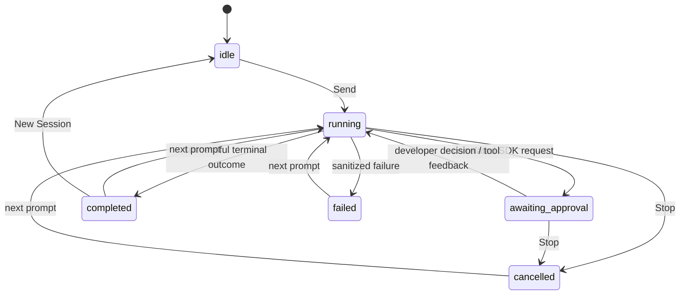

# Agent Panel and terminal MCP verification — 19 November 2026

**Verdict: CONDITIONAL.** Implementation, 115-test regressions, genuine command
approval/denial/cancellation and genuine failure-to-correction execution passed.
The final installed build passes deterministic/SDK/native-host checks, including
actual renderer startup under CSP. The latest fresh model repeat timed out after
context retrieval; further model requests were stopped. Successful live evidence
is retained with the earlier verified bundle identity. Subsequent presentation changes clear an undone proposal from the panel/tree and
label native-progress cancellation as cancelled rather than failed. No claim that
the final provider repeat passed is made. Physical GUI clicks are **NOT TESTED**.

This is a focused post-Phase-5 change on `feat/phase-3-autonomous-agent`, based on
`b16ac2314d32f94a0d617d7b935170870f0b7178`. It is not Phase 6. Historical Phase
3/4/5 reports and Task B output remain dated evidence. No Task B model run, video,
submission PDF, publication, commit, push, PR modification or merge is part of this work.

## 1. Official requirement mapping

The retained official PDF `/tmp/forgepilot-phase5-spec.pdf` and extracted text were
read. SHA-256: `5feeee151edc6bf098743e6eaf5e87b8996adc7bc13abbe1fc8409074d6ddb49`.
The [official source](https://techfest.org/media/compiProbStatement/TrueFoundry_Forge-a-thon_compressed_UvvRJ9C.pdf)
could not be opened by the web reader during this update; the retained copy matches
the previously recorded checksum. The literal requirements are paraphrased below.

| Literal requirement | Implementation / acceptance boundary |
| --- | --- |
| Agent mode has an editor panel accepting one task | Dedicated supported Agent WebviewView in a ForgePilot activity-bar container |
| TrueForge owns the read/search/propose-write/command loop | Existing SDK sessions and temporary MCP connector, now including `run_command`; no direct provider requests |
| Discover and change at least three files without naming them | Existing Phase 3 discovery/retained-draft/batch path preserved; original Task B archive replayed, not regenerated or retroactively described as panel/terminal evidence |
| Tokens arrive through TrueForge streaming events | Actual `model.message.delta` mapping with incremental DOM append; final-only messages display once |
| Interrupt generation without half-applied edits | Existing backend cancellation plus request/terminal-grant revocation and stale UI suppression |
| Hunk preview, explicit decisions and undo | Existing native diffs, batch review, `EditCoordinator`, accepted-only apply and guarded undo |
| Editor capabilities are MCP tools | Real authenticated remote MCP discovery, including command tool; SDK source/call-correlated approval |

The official text does not demand an unrestricted shell, a frontend framework,
unattended tests, network installation, arbitrary executables or cross-platform
terminal execution. Typed, approved verification commands are the implementation
choice. Rich history, activity details, accessible controls and context access are
additional acceptance requirements from this engineering task.

## 2. Agent Panel

Run **ForgePilot: Autonomous Agent** to focus **ForgePilot → Agent**. A supplied
string still submits directly. The existing inline InputBox and all 25 original
commands remain; **New Agent Session** is command 26.

The panel includes conversation history, prompt/Send, streamed assistant text,
actual model and backend session, idle/running/awaiting approval/completed/failed/
cancelled state, Stop, New Session, tool timeline, collapsible details, Context,
file list, proposal status, native diffs, hunk review, Apply Accepted and Undo Batch.
Staged, applied and partially applied batches are visibly distinct. A failed or
cancelled generation removes the current panel proposal.

The renderer uses local JavaScript/CSS and VS Code theme variables. Text wraps in
narrow sidebars; buttons/textarea/details are keyboard accessible, with labels,
focus outlines, status/alert regions and Ctrl/Cmd+Enter. Scrolling follows new
output until the developer scrolls up; completion restores input focus when the
webview owns focus. Physical usability/contrast/assistive-technology inspection
is **NOT TESTED**.

## 3. Components and state transitions

`AgentPanel` provides the view and validates incoming messages. `PanelState`
holds bounded presentation data. The existing `Autonomous` controller owns batch
state and delegates execution to `ResilientBridge`/`Bridge`. The existing
`BatchStore` and `EditCoordinator` retain editing authority.



New Session first cancels/revokes and awaits the prior request, then closes the
owned bridge/connector and clears panel history. It does not delete saved agents,
historical sessions or unrelated connectors. A fresh authorized TrueForge session
is created lazily on Send. Each request already gets fresh backend state through
Phase 4 resilience; bounded prior conversation/tool summaries are passed as
untrusted task context for follow-ups, never as approval. Local panel session and
backend session IDs are deliberately separate and the actual backend is displayed.

## 4. Streaming and lifecycle

SDK events feed the existing Output renderer and a separate presentation mapping.
Real deltas append text nodes; completed messages are not split into fake chunks.
The provider batches outgoing events every 35 ms. Snapshots occur on initialization
and request/reset boundaries. Tool rows update in place. Context observations
report real estimated-token metadata and link to the existing inspector.

Request/session IDs gate every view action and async update. Cancellation clears
the request identity before waiting for the backend. Late stream/approval answers
cannot update or authorize the next request. Provider disposal removes listeners
and timers and cancels work. On fallback, prior unfinished activity is marked
cancelled and the displayed identity changes to the new owned session/model.

## 5. Webview and editing security

The CSP denies resources by default, permits only the nonce-protected local script
and local stylesheet/resources, and prohibits forms/base navigation. Model/source
text uses `textContent`/text nodes. No Markdown HTML renderer, remote scripts,
provider access, credentials, approval buttons or arbitrary command dispatch is
present. Strict schemas reject unknown fields, malformed IDs and oversized input.
The view stores no persisted `setState` data or authentication material.

SDK staging approval remains separate from developer hunk decisions and guarded
apply. The panel cannot accept hunks on model output. File links call the existing
native diff provider. Apply reuses `EditCoordinator`; undecided/stale targets are
refused. Partial application means accepted hunks applied and rejected hunks
excluded, not a claimed atomic filesystem transaction. Normal editor saving is
still required. Guarded undo refuses intervening user/external changes.

## 6. Terminal MCP schema and command policy

`run_command` is advertised only on autonomous connectors. The strict schema is:

```ts
{
  operation: 'git_status' | 'git_diff_check' | 'pytest' | 'npm_test' | 'cli_help',
  cwd?: string,                  // default '.', relative authorized directory
  testPaths?: string[],          // pytest only: 1–8 bounded test*.py paths
  script?: 'test' | 'test:unit' | 'lint', // npm_test only
  timeoutSeconds?: number        // integer 1–120, default 30
}
```

| Operation | Generated process arguments (fixed protective Git flags omitted here) |
| --- | --- |
| `git_status` | `/usr/bin/git status --short --untracked-files=normal` |
| `git_diff_check` | `/usr/bin/git diff --no-ext-diff --no-textconv --check` |
| `cli_help` | `/usr/bin/git --help` |
| `pytest` | `/usr/bin/python3 -B -m pytest -q -p no:cacheprovider -- <testPaths>` |
| `npm_test` | `/usr/bin/node /usr/lib/node_modules/npm/bin/npm-cli.js --offline --ignore-scripts run <script>` |

Git disables optional locks, paging, fsmonitor and hooks, and overrides global
attributes; global/system Git config and interactive authentication are disabled.
There are no model-selected executables, environment variables or arbitrary flags.
Path syntax is a structural grammar, not a shell blacklist. Absolute paths,
traversal, alternate separators, hidden/sensitive components, symbolic links and
non-regular/hardlinked test targets are rejected. Canonical workspace/directory
identities are checked again against the approval.

No `sh -c`, `bash -c`, `eval`, inline interpreter code, model-generated chains,
redirects, downloads/installs, deletion, destructive Git operations or daemons are
exposed. An expressly approved npm script/pytest file can itself execute arbitrary
repository code; that fact is disclosed and OS isolation constrains its effects.
Tests are not described as inherently read-only.

## 7. Approval lifecycle

1. TrueForge discovers `run_command`, which is eagerly loaded and included in
   `requireApprovalForTools`.
2. The bridge resolves the exact model tool call and source event, including
   TrueForge's deferred `call_tool` wrapper where applicable.
3. The command is parsed/planned and the native **Run Once / Reject** dialog shows
   the executable, complete JSON argument list, root, cwd, timeout and risks.
4. A positive native decision issues an acknowledged private-IPC grant bound to
   request scope, call/source/approval event IDs, canonical request digest and
   directory identity, then submits `user.tool_approval` through the SDK.
5. The companion consumes this one grant before any await/spawn. A duplicate,
   stale or different request cannot use it. There is no MCP grant tool.
6. Refusal submits denial, never issues a grant and executes zero times. The agent
   can receive denial feedback. A later provider failure cannot trigger fallback
   after refusal. Staging approval is never reused as command approval.

Only trusted local workspaces reach this path. Trust alone never grants command
permission. Malformed/unsupported requests fail closed before confirmation.
Verification drivers explicitly automate decisions in disposable fixtures; these
are not claimed to be physical developer clicks or production auto-approval.

## 8. Execution environment, results and cleanup

Commands require Linux Bubblewrap with user/PID/network/IPC namespace support.
Only `/usr`, system binary/library paths and the authorized workspace are mounted
read-only. Host home, host `/tmp`, provider settings and arbitrary host folders
are absent. New `/proc`, `/dev` and 64 MiB temporary scratch are provided.
Capabilities are dropped and networking is isolated. The child gets a fixed
minimal environment; provider keys, companion tokens, proxies, `NODE_OPTIONS`,
`PYTHONPATH` and arbitrary inherited variables are not passed.

Each command has a 1–120-second timeout capped by machine-scoped
`forgepilot.commandTimeoutSeconds`. stdout/stderr share a 12,000-byte budget but
remain separate. Excess output is explicitly truncated and terminates execution.
Results contain category, safe argument summary, actual exit code or null,
termination (`exited`, `denied`, `cancelled`, `timeout`, `output_limit`,
`unavailable`), elapsed milliseconds, stdout/stderr and timeout/cancel flags.
Private Bubblewrap JSON status distinguishes command exits from setup failure;
wrapper failures are never invented as successful command exits.

Timeout/cancel/Stop kills the process group; Bubblewrap's PID namespace contains
detached descendants, and parent-death handling/companion IPC loss closes access.
Companion shutdown awaits command completion before closing. Scope revocation is
acknowledged before fallback or another request. The Linux tests verify actual
running-command Stop and detached-child cleanup. This is not a promise of perfect
cleanup on every OS/kernel or against kernel compromise.

## 9. Output and prompt handling

Terminal controls and recognized bearer/token/secret/password/API-key markers are
redacted before tool results reach the model/UI. Both streams are tested. This is
best-effort redaction, not a universal secret detector. Approved repository code
can print unknown secrets from accessible files; the native approval warning
states that output may reach TrueForge and its model. Companion logs contain
metadata only. The context inspector omits command output, and the panel retains
it only in bounded process memory. TrueForge may persist tool responses in its
historical session; ForgePilot does not erase that evidence or claim ephemeral
provider retention.

Tool output and conversation are untrusted task data, never authorization. No
assistant text is parsed as permission. A nonzero command result permits the
TrueForge turn to continue normally; retained corrections still need fresh staging
approval and explicit hunk review/apply.

## 10. Automated tests

The original **83 tests are retained**. The discovery cardinality assertion was
updated from 17 to 18 for the added tool; it remains an exact assertion. The new
test files add **32 cases**:

| Suite | Cases | Covered boundaries |
| --- | ---: | --- |
| `tests/panel.test.ts` | 8 | Contributions/26 commands, strict message schemas, real SDK event mapping, incremental delivery, tool/identity/state, cancellation/reset, staged/partial proposals, CSP/text-only source checks, runtime non-JSON denial regression |
| `tests/panel-renderer.test.ts` | 4 | Actual shipped script in an explicitly minimal DOM fixture: in-place append, stale messages, literal HTML, keyboard/input actions, staged Apply restrictions, tool details, scrolling/focus |
| `tests/terminal.test.ts` | 14 | Typed payloads, injections/dangerous args, traversal/symlinks, approval/denial/replay/exactly-once, actual stdout/stderr/exit 7, subsequent commands, timeout/detached descendants, overflow, cancellation/stale scopes, directory identity, read-only filesystem/network/env, redaction, Stop/companion cleanup and real MCP registration |
| `tests/terminal-approval.test.ts` | 6 | Real SDK wire + real companion subprocesses: failed-command feedback → retained correction → separate staging/pending hunks; denied zero execution; no fallback after denial/provider error; late approval cancellation; fresh grants on fallback; source-event mismatch |

The extension-host suite adds actual WebviewView resolution, prompt-message
routing, the shipped script's actual CSP/ready handshake, command feedback,
native context/diffs, guarded pre-review refusal,
accepted apply/undo, malformed/stale messages, late events after cancellation and
disposal. Successful undo clears the proposal rather than leaving it labelled
applied. Original inline/batch/resilience host assertions remain.

Final exact counts and logs are in [verification evidence](evidence/agent-panel-terminal/verification.json).
The renderer DOM fixture is not a browser/physical-click test. Actual VS Code
view registration/native editor APIs are separately verified by extension hosts.

## 11. Required regressions

`npm ci`, `npm run check`, `npm run test:live`, `npm run test:editing:live`,
`npm run package:extension` and `npm audit --json` were executed. Initial sandbox
network/localhost restrictions required rerunning affected commands with explicit
execution permission. Node 22.23.5 and 24.22.3 are tested using cached runtimes.
Audit reports zero known vulnerabilities, including zero High/Critical. No runtime
dependency or lockfile change was introduced.

| Check | Final result |
| --- | --- |
| `npm ci` | PASS |
| `npm run check` | PASS — 115/115, build and lint |
| Node 22.23.5 / 24.22.3 | PASS — 115/115 each; earlier CI-equivalent build/lint checks also passed |
| `npm run test:live` | PASS — genuine read-only stream/MCP/history/cleanup |
| `npm run test:editing:live` | PASS — genuine staging/mixed decisions/cancellation |
| `npm run package:extension` | PASS — final package installed using CLI wrapper |
| `npm audit --json` | PASS — zero advisories |
| Final installed native host | PASS — 26 commands, renderer ready/CSP, review/apply/undo, cancellation/disposal and original suites |
| Genuine panel approve/deny/cancel | PASS on the earlier verified build; exact IDs/hashes retained |
| Genuine failing-command → model correction | PASS on the earlier verified build, including native apply, verification and undo |
| Final fresh live repeatability | BLOCKED — latest provider attempt timed out after context retrieval; no command approval/execution |

Live read-only session `01m7sy08gxgcjca5vjmt19rkjk` used
`google-gemini/gemini-3-1-flash-lite`, four genuine deltas, actual discovery/read
results, unchanged file hashes and successful connector cleanup. Live inline
session `01m7sy3ssrz7c5090qffs5cr08` passed staging/mixed-hunk validation and
cancellation while awaiting approval/during streaming.

The offline Task B replay used a fresh local clone at
`22d924701a6ae2e4cd01e9a15bbaf3946094af65`, reconstructed six original batches/22
hunk decisions, matched exact archived patch/file hashes and passed **59 CLI**
and **113 combined CLI/helper/config tests**, help discovery and masking/unchanged
configuration checks. No new Flask model run occurred. Task A native behavior and
Phase 4 failure/fallback protections remain covered by original tests/hosts.

## 12. Genuine TrueForge evidence and discovered defects

TrueForge runtime **0.185.1**, SDK **0.185.0**. Its existing database was reused
after restarting the stopped cached runtime. Both saved agent IDs/manifests match
the recorded Phase 5 hashes; no credential, endpoint or billing change occurred.

An initial local setup attempt was safely refused while the legacy named-agent
editing regression still owned a connector; it made no model request. After that
driver detached, the first provider-backed terminal attempt discovered all 18 tools in session
`01m7syafwd4410f54xr2rbfewd` but Gemini returned HTTP 503 before a command call.
One bounded attempt with saved `forge-coder-openrouter` discovered the tool but
reported exhausted daily quota. No OpenRouter retries followed. The failed
attempts are retained separately, not counted as successful invocation.

A subsequent genuine installed-panel run used Gemini session
`01m7sz8fdw3x428t97j3c7d1k9` and returned actual Git-status exit 0. Its denial
check exposed a presentation defect: runtime non-JSON denial feedback was labelled
completed. SDK denial/no command grant was correct. `PanelState.observation` now
preserves rejected state, and a specific regression test covers that real format.
The original failed UI-check evidence is retained rather than relabelled PASS.

The completed approved/denied/cancelled live evidence is recorded in
[installed panel live evidence](evidence/agent-panel-terminal/installed-live.json).
These are genuine model requests through the actual installed panel controller,
with explicitly automated acceptance approvals and programmatic native APIs.
Physical GUI clicks are **NOT TESTED**. No mocked model call is counted as genuine.

| Decision | Session | Tool call | Approval event | Actual result |
| --- | --- | --- | --- | --- |
| Approve | `01m7szpbear3wy1qjkectcgjky` | `call_13399492493891964455` | `01m7szpfvaseqmd7s9c8nykeps` | `git_status`, exit **0**, 7 ms, real stdout |
| Deny | `01m7szphjy38yc9245wgyxmsan` | `call_7770636601026586566` | `01m7szqphw55qr21a7gydqzveb` | Persisted SDK deny; no command grant/execution |
| Cancel | `01m7szqwsd3t4473swp6f3ad4r` | `call_13378583209034077759` | `01m7szr6f2ahp0yyk0cmjxhbr5` | Backend cancellation while approval pending; delayed allow suppressed |

All three used `google-gemini/gemini-3-1-flash-lite`, and connector cleanup passed.
The source-event IDs and actual persisted tool-call payloads are retained in JSON.

The [genuine correction check](evidence/agent-panel-terminal/correction-live.json),
session `01m7t0003e0db3eqwj14sm68fz`, used the same model. Its explicitly approved
`npm_test` returned an actual assertion failure/nonzero exit. The model then
retained a corrected calculator draft, checked it and requested separate staging
permission. Native hunks remained pending; apply before review refused. Explicit
automated hunk acceptance/guarded apply followed by a developer-operated Node
verifier passed, and guarded undo restored the original. This was a tiny fixture,
not a new Flask Task B run. Terminal output did not approve or apply the correction.

Those passing runs used extension bundle
`0a3026c52667fd200d2976b324bf327cfc4e9653e38bc17b57297da94d00c3b6`.
Final inspection fixed the stale applied label after undo by clearing the
proposal pointer. A later presentation fix classifies native-progress cancellation
as cancelled. Current bundle and unchanged MCP child hashes are below.
The latest fresh installed-panel repeat, session `01m7t05mz8nj74yn98t764dpyd`,
performed genuine context retrieval but timed out before any terminal approval.
It is [retained as BLOCKED](evidence/agent-panel-terminal/final-installed-live.json),
not overwritten by earlier success. No further inference was attempted. Final
native/SDK fixtures pass with both label fixes and the actual renderer ready message.
The last cancellation-label adjustment was verified without additional inference
after that provider timeout; current fresh live repeatability remains BLOCKED.

## 13. Installed VSIX identity

Packaging includes 15 entries: manifest/XML, metadata, transformed README/license,
three credential-free agent definitions/env example, two runtime bundles, bundled
notices and three panel assets. Tests, source maps, evidence, source and test bundle
are excluded. The proper `/opt/visual-studio-code/bin/code` wrapper installs it with
`--install-extension ./artifacts/forgepilot.vsix --force`.

The installed host loads
`/home/nipun/.vscode/extensions/nipunkalsotra.forgepilot-0.1.0`. It checks the actual
runtime bundle and all three media hashes against current workspace bytes before
tests, plus all **26/26** contributed registrations. Package/source/installed
hashes and VSIX SHA-256 are in [package identity](evidence/agent-panel-terminal/package.json).
Version alone is not used as identity. A normal already-open editor window still
requires **Developer: Reload Window**; that physical reload is **NOT TESTED**.

- Final VSIX SHA-256: `e200cc6ffe31262db4e7fe49ea132f6ce08d70e9a4bd98e051aee3cba0aedcde`.
- Final `extension.cjs`: `c5829dbeb04ce93587cf576cb1f8b197963853a605724766244c283725ef0367`.
- `mcp-child.cjs` (identical across successful live and final builds):
  `a0f590a0605f35b58d09e654c9fd3e5eee5fbd0e72c56931993da2342f084d7b`.

## 14. Remaining unsupported behavior / security limits

- Agent command execution on Windows/macOS, remote/virtual workspaces and systems
  without usable Linux Bubblewrap is unsupported and refuses execution.
- System runtime paths are fixed. System pytest is absent on this machine;
  external project virtual environments are not mounted. Real npm fixture tests
  were executed; no claim that the agent ran Flask pytest through this tool is made.
- Verification uses saved disk content, not staged patches/unsaved buffers. A
  source-writing build, repository cache writes, external resources or network
  installs can fail intentionally. Developer terminal remains available separately.
- Approved tests are arbitrary repository code inside a sandbox, not mathematically
  safe programs. Unknown secrets, resource exhaustion before the deadline, exposed
  workspace IPC sockets, hostile system executables, kernel/sandbox exploits and
  adversarial same-user processes are not exhaustively defended/tested. No separate
  per-process CPU/memory/cgroup quota is claimed; scratch/output/time are bounded.
- Workspace/directory checks reduce races but do not provide an OS atomic
  check-and-mount guarantee. Existing editor dispatch races remain documented.
- UI/draft/undo state is in memory; restart loses it. Follow-up context is bounded,
  not a promise of lossless conversation replay. Actual minimum VS Code version,
  physical focus/screen-reader interaction and normal-window reload are NOT TESTED.
- Provider capacity remains external. There are no uncontrolled retries, model
  credentials changes, paid infrastructure or automatic test execution after every
  proposal. No full new Task B live run is claimed. The genuine calculator
  failed-test/model-correction check is identified separately above; final fresh
  terminal repetition is blocked by provider timeout, with no further retries.

These limits do not silently broaden terminal permission or grant source writes.
Literal panel/command capabilities are implemented; competition on-screen proof,
cross-platform command execution, arbitrary interactive terminals and a new full
Task B run remain unclaimed. Current provider availability is a condition on live
repeatability, not disguised as a mock-model success.

## 15. Exact changes and delivery

The complete path list, Git state, final tests and verdict are retained in
[verification.json](evidence/agent-panel-terminal/verification.json). Production
changes are limited to panel presentation, optional autonomous stream/command
hooks, correlated command approval/private IPC, MCP registration and sandbox
execution. Tests and packaging checks were extended. README/architecture/current
verification were updated; historical reports remain intact except the explicit
dated Phase 5 cross-reference above.

No commit/push/branch creation/reset, PR #1 modification, main modification,
extension publication or competition submission was performed. Changes remain
uncommitted on the requested branch. Final verdict is stated in the evidence and
delivery report, with physical GUI verification kept separate.

Because commit/push is explicitly prohibited, new report links in the packaged
README are not yet available on the remote branch; the workspace copies and
local evidence are the reviewable delivery.

## 16. Complete modified file list

```text
README.md
docs/agent-panel-terminal-verification.md
docs/architecture.md
docs/evidence/agent-panel-terminal/audit.json
docs/evidence/agent-panel-terminal/check.txt
docs/evidence/agent-panel-terminal/configuration.json
docs/evidence/agent-panel-terminal/correction-live-pass.txt
docs/evidence/agent-panel-terminal/correction-live.json
docs/evidence/agent-panel-terminal/final-installed-live.json
docs/evidence/agent-panel-terminal/final-installed-live.txt
docs/evidence/agent-panel-terminal/installed-host.txt
docs/evidence/agent-panel-terminal/installed-live.json
docs/evidence/agent-panel-terminal/installed-panel-live-pass.txt
docs/evidence/agent-panel-terminal/node22.txt
docs/evidence/agent-panel-terminal/node24.txt
docs/evidence/agent-panel-terminal/package.json
docs/evidence/agent-panel-terminal/provider-attempts.json
docs/evidence/agent-panel-terminal/regressions.json
docs/evidence/agent-panel-terminal/verification.json
docs/phase-5-final-verification.md
eslint.config.mjs
media/agent.css
media/agent.js
media/forgepilot.svg
package.json
scripts/verify-extension.ts
scripts/verify-panel-terminal-live.ts
src/autonomous.ts
src/bridge.ts
src/companion.ts
src/extension.ts
src/mcp/autonomous.ts
src/mcp/child.ts
src/mcp/server.ts
src/panel-state.ts
src/panel.ts
src/resilience.ts
src/terminal.ts
tests/extension-host.ts
tests/mcp.test.ts
tests/panel-host.ts
tests/panel-renderer.test.ts
tests/panel.test.ts
tests/terminal-approval.test.ts
tests/terminal-wire-fixture.ts
tests/terminal.test.ts
```
