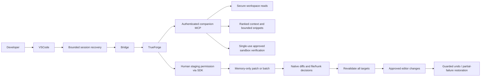

# ForgePilot architecture

The extension is a client of the existing saved TrueForge agent. `ResilientBridge` selects a saved agent; `Bridge` owns one TrueForge session and a temporary authenticated companion connector. The companion exposes bounded repository capabilities over stateless MCP HTTP; TrueForge owns model execution, tool choice and iteration. No direct provider call, unrestricted shell, workspace write or approval tool is offered to the model.

`Workspace` preserves path, symlink, hardlink, UTF-8, file-descriptor and size safeguards. Legacy reads remain limited to 64 KiB. Autonomous inventory uses fixed-argument `git ls-files --cached --others --exclude-standard` without hooks/fsmonitor or a bounded fallback walk. Every returned path is revalidated; Git tracking never grants authority to read a forbidden path. Line-range reading is a distinct, bounded API for larger sources. New-file proposals validate the existing parent and absence of a target without creating directories or files.

## Post-Phase-5 Agent Panel and verification commands

`AgentPanel` is a supported `WebviewViewProvider` in its own ForgePilot activity-bar container. Its local JavaScript/CSS uses VS Code theme variables, text nodes, semantic controls and collapsible tool rows. `PanelState` maps genuine SDK text deltas and tool activity into incremental messages; the provider batches delivery every 35 ms. Completed messages are displayed once, never split into invented streaming chunks. Full snapshots occur on initialization/request boundaries. Conversation/output remain in bounded process memory; authentication material is never sent to the webview or persisted with `setState`.

The panel calls `Autonomous` → `ResilientBridge` → `Bridge`. Bounded prior conversation is carried as untrusted task data into each request's fresh backend session, preserving Phase 4 isolation. Visible backend identity comes from actual stream ownership. No model loop/provider API was added. Idle → running → awaiting approval → running → completed/failed/cancelled is presentation state only. Proposal status comes from `BatchStore`; native diffs, accepted/rejected counts, guarded apply and undo use existing components. Failed/cancelled generations cannot present a current proposal. New Session closes only owned backend state and preserves historical sessions.

`run_command` is registered only for autonomous connectors, eagerly discoverable and listed in `requireApprovalForTools`. A strict typed schema selects fixed verification operations. Exact source-event/call/approval IDs are resolved through SDK events before native confirmation. A successful decision issues an acknowledged private-IPC grant bound to the current request scope, canonical command digest and directory identity. The companion consumes it before any await/spawn. Model/MCP/webview messages cannot issue grants. Staging permission grants no command authority. Denial executes zero times and may return normal feedback; a subsequent provider error after denial cannot trigger fallback.

`CommandAuthority` revalidates paths, rejects symlinks/traversal and uses system Bubblewrap on Linux. Read-only workspace/system mounts, new PID/network/IPC namespaces, dropped capabilities, temporary scratch, minimal environment, process-group kill and parent-death handling constrain repository-controlled test code. Provider credentials/companion tokens are not inherited. Setup failure refuses execution. A private JSON status descriptor supplies command exit codes; wrapper failures never become invented command successes. stdout/stderr remain separate under a combined 12,000-byte bound. Timeout, overflow, cancellation, missing authority and sandbox unavailability have explicit outcomes. Known credential markers/control sequences are sanitized; unknown repository secrets can still appear. Output is transient in the panel; TrueForge can retain tool responses in history.

Cancellation/stop/fallback invalidates pending grants, aborts commands and clears candidate proposals before another session. Terminal failure permits an otherwise healthy model turn to continue with actual feedback, retained drafts and new staging permission. Tests see saved disk content through read-only mounts and cannot apply patches. System pytest dependencies must exist in the exposed runtime; external environments, network installs and source-writing builds are unsupported. See [verification and limitations](agent-panel-terminal-verification.md). Historical Phase 3/4/5 evidence predates these capabilities.

`ContextEngine` first enumerates permitted candidates, ranks filename and lexical evidence and extracts declaration/import relationships. It favors related implementation/test/documentation locations, then assembles short snippets within an explicit estimated-token and serialized-response budget. Candidate reasons, scan counts, truncation, omissions, selected content and file hashes are genuine tool outputs. The budget is per package. Additional tool messages and provider context compaction remain TrueForge's responsibility.

Inline editing continues to use `PatchStore` and `Editing`. Autonomous editing uses `BatchStore`, which reuses `PatchStore` validation and `diffHunks` for existing files. A separate read-only `check_batch` tool runs the same domain validation on an ephemeral draft and returns feedback to the TrueForge-owned loop; it does not create a reviewable extension proposal or grant approval. New files form explicitly reviewed addition hunks. Paths cannot repeat within a batch, and replacements cannot overlap. Every file records identity/creation state, baseline hash, applicable document version, decisions, status and conflict state. A staged batch remains incomplete until the agent reaches an explicitly successful terminal state.

Recovery adds `DraftStore`, scoped to a generated autonomous request ID within the existing companion. The bridge begins and invalidates scopes through acknowledged private IPC; the model never has to supply that ID. Cancellation/completion clear retained drafts; in-flight validations cannot revive them. `list_drafts` recovers current IDs after compaction. `draft_file` validates and retains one complete file draft; one entry per path, at most 12 files/90,000 serialized bytes. A replacement reaching domain validation invalidates the old ID, including failed corrections. Rotated scopes cannot reactivate; at most 64 retired scopes are retained before requiring a fresh session. `check_drafts` independently revalidates selected files and `propose_drafts` assembles/revalidates the final batch under genuine tool approval. The bridge correlates successful draft responses to actual tool arguments/current scope, validates approved content, then rejects a final response that differs from it. No draft grants application permission.

Final recovery makes replacement intent explicit: repeated valid submissions without `replaceDraftId` return `DRAFT_EXISTS` and retain the known valid draft. `extend_draft` combines additional disjoint original replacements with that draft, revalidates the entire file, and rotates its ID. A failed extension/correction invalidates the affected file's draft; superseded IDs never reactivate. Other files are retained. `list_drafts` exposes last-validated hashes and edit counts as well as IDs; final hashes are still rechecked. The bridge reconstructs extended proposals from correlated original tool arguments, then compares the exact approved final payload. This adds no writes or approvals to draft tools.

`outline_file` returns at most 100 heuristic declaration/heading locations and a full-file hash from the same secure read policy. It supports targeted ranges rather than sequential long-file reads; it is not an AST parser. Generic draft/retrieval rules are appended to isolated autonomous session instructions, and compaction is configured there at 64,000 input tokens. Saved agent manifests are not modified. Source code and task data cannot grant permission.

`check_batch` now returns independent typed diagnostics even for malformed variants or duplicate paths. Codes distinguish hashes, missing/nonunique anchors, overlaps, missing/existing targets and policy errors. `check_anchor` verifies a bounded exact original snippet without returning unrelated contents or doing fuzzy repairs. Model corrections stay inside the TrueForge loop. Retained IDs avoid repeated complete patch generation and echoed validation payloads. The first retrieval is one context query, with targeted reads thereafter; inventory is no longer a mandatory extra round trip.

For autonomous runs, context, range reads, search and proposal schemas are eager; inventory, symbol and legacy schemas are deferred. Installed TrueForge exposes `list_tools`, `get_tool_info`, and `call_tool`. Its persisted wrapper calls may have `truefoundry-system` tool info, so the bridge validates the exact wrapper's server and underlying tool name, source event and call ID before asking for staging approval. SDK `createTurnEvents` carries `user.tool_approval` and supported native `user.tool_response` inputs. No approval is inferred from assistant output. Developer rejection, cancellation, failed completion and malformed output revoke the proposal request.

`Autonomous` supplies native grouped review trees, text-diff providers, Quick Picks, an observable context inspector and progress/cancellation. `EditCoordinator` revalidates all batch targets before a single editor dispatch and rechecks document versions/content after asynchronous disk checks. Only accepted hunks enter that operation. The host uses `WorkspaceEdit` for edits and reviewed creations; file saves remain normal editor actions. The coordinator verifies the result, records the immediately preceding state, and refuses undo after unrelated changes.

If editor application returns false, throws or produces unexpected content, only recognized applied portions with unchanged versions/content and valid disk state are candidates for restoration. Unknown/user-modified portions are preserved and reported for inspection. Undo failure or partial restoration is also reported. These are guarded editor operations, not an OS transaction, lock, or public version CAS. Concurrent edits after the final check remain a documented race; users should not edit affected documents during dispatch.

Cancellation checks run around asynchronous event processing and invalidate both proposal stores and request generations. The SDK cancels the backend turn, not just the socket. If cancellation cannot be acknowledged, companion termination revokes local access. Explicit stop detaches only the owned connector and preserves session history. The production editor uses SDK `CreateSessionAgent.spec` to snapshot a saved agent into an inline session, attaching its own connector without updating the shared saved manifest. Legacy standalone drivers retain named-session compatibility and should run sequentially because that older attachment API has no conditional update.

Optional autonomous response pacing serializes MCP result delivery through a cancellable timer chain. It reduces request bursts for limited provider plans; it does not make or retry model calls. The server aborts pending pacing waits and tracked Git subprocesses during shutdown.

Live drivers default to 0 ms, with an explicit test override. At 10,000 ms the previous chain imposed at least 250 seconds for 25 tool responses. TrueForge's cumulative input/output/cache/reasoning metrics are recorded separately from retrieval byte estimates. Historical native compaction ran during OpenRouter Task B attempts at the initial 32,000-token trigger, followed by metadata/operation mistakes. The final isolated protocol/64,000 configuration has since passed genuine generic multi-file runs; the current official-task result is recorded in [final acceptance](phase-3-final-acceptance.md). Gemini explicitly reported a 250,000 free-tier input-tokens/minute limit during recovery; a fresh test request used 5,000 ms pacing. This is a test/user configuration, not automatic provider retry or capacity detection. Registry/turn/application mutations are never blindly retried.

## Phase 4 resilience

`failure.ts` maps bounded SDK metadata and terminal error messages into typed categories. A `RequestFailure` retains its original cause for internal handling; public messages and metadata logs omit raw responses, headers, credentials and task/source text. HTTP 401/403, model configuration, 429/daily quotas, 502/503/504, networking and timeouts remain distinct from stream failures, patch validation, denied approval, cancellation and conflicts. The branded type remains recognizable across VS Code module bundles. Successful completion is still mandatory; unknown/incomplete outcomes fail closed.

`ResilientBridge` coordinates at most two TrueForge-owned executions per request. Fallback is disabled by default and needs a distinct machine-scoped saved agent name. A recognized eligible failure closes the old bridge before a new isolated session is created. No saved provider or agent manifest is rewritten. The new bridge has a new connector token/name, source-event/call-ID maps and draft scope. The task and authorized selection/root are reused; primary drafts, approvals and model conversation are not.

Each attempt uses a separate disposable proposal store. A successful terminal outcome is required before a fresh, independently revalidated proposal is adopted into the UI's store. Failed candidates are irreversibly cancelled before fallback. Batches use `BatchStore.fork()` to retain the authorized baseline callback but no proposal state. File application remains outside this coordinator, in `Editing`/`EditCoordinator` after all hunk decisions. Recovery neither repeats an application nor rolls back already accepted edits automatically.

The state sequence is idle → primary setup/stream/approval → success, or failure → cancel/revoke → fallback setup/stream/approval → success/failure. Any user cancellation moves toward cancel/revoke and cannot switch models. There is no recursive transition. Developer denial takes precedence even if the SDK request submitting it fails, and failure cleanup cannot create a new generation timeout. A deadline during a model request may be eligible; a deadline while awaiting human input is local and cannot trigger fallback. Both-provider failure reports both sanitized categories. A subsequent manual request creates fresh execution state.

Startup SDK operations receive abort signals; turns retain stream abort, backend cancellation and draft invalidation. Control-plane requests use a 10-second SDK timeout, backend cancellation five seconds, draft IPC five seconds, companion termination escalates after 2.5 seconds, and generation has a configurable 10–600-second deadline per attempt. Cleanup is awaited; an unacknowledged registry cleanup prevents fallback and closes local access. These are bounded individual operations, not a hard real-time overall SLA. No registry/turn/application mutation is blindly retried. No same-provider backoff policy was added; automatic fallback is the chosen recovery path.

Progress/listeners are disposed in `finally`, busy flags reset on all exits, and session/model/connector/outcome/actual metrics are exposed as sanitized recovery evidence. The actual Task C host kept a 25ms timer running during provider errors and editing. This establishes event-loop responsiveness in that environment, not physical keyboard/mouse behavior or a guarantee of zero scheduling latency. Physical UI checks, Windows/macOS and competition recording remain pending.

## Final engineering resource policy

`TokenBudgetManager` supplies strict runtime configuration, cumulative per-turn
SDK accounting and separately labelled UTF-8 estimates. Autonomous requests share
one parent accounting object across the authorized one-time fallback; a new user
request starts fresh. The companion receives only configuration and a bounded
prompt/spend seed over private IPC. It gates tools before execution and paces
responses against explicitly configured limits. The parent observes correlated
SDK responses, tracks actual final metrics (including failed turns) and publishes
usage to the panel. These are separate views of the same activity, never added
together. Post-turn data cannot provide exact in-flight billing or provider-global
rate enforcement. Quota remains unknown. Off is compatible; conservative is
recommended. Strict stops nonessential tools, preserving checks/staging/cleanup.

Context snapshots are local to one retrieval. Selected full-file hashes are
revalidated before cached text supplies snippets; changed snapshots are omitted
with truncation evidence. Range deduplication retains only hash/range keys (128),
not source, and only suppresses a response if smaller. New scopes, invalidation
and native TrueForge compaction clear those keys. The engine is shared across
stateless HTTP transports inside the current companion scope.

Current `list_drafts` metadata is a bounded checkpoint for native compaction,
not a separate conversation store. Failed requests retain only path/hash progress,
no draft IDs or grants. There is no cross-session restore. JSON/CommonJS preflight
parses source without running it; imports and behavior remain unverified. Disposable
candidate execution remains unsupported, preserving the sandbox/review boundary.
See [final acceptance](final-engineering-acceptance.md) for current tests and limits.
