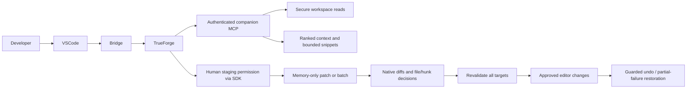

# ForgePilot architecture

The extension is a client of the existing saved TrueForge agent. `Bridge` owns one named session and a temporary authenticated companion connector. The companion exposes bounded repository capabilities over stateless MCP HTTP; TrueForge owns model execution, tool choice and iteration. No direct provider call, unrestricted shell, workspace write or approval tool is offered to the model.

`Workspace` preserves path, symlink, hardlink, UTF-8, file-descriptor and size safeguards. Legacy reads remain limited to 64 KiB. Autonomous inventory uses fixed-argument `git ls-files --cached --others --exclude-standard` without hooks/fsmonitor or a bounded fallback walk. Every returned path is revalidated; Git tracking never grants authority to read a forbidden path. Line-range reading is a distinct, bounded API for larger sources. New-file proposals validate the existing parent and absence of a target without creating directories or files.

`ContextEngine` first enumerates permitted candidates, ranks filename and lexical evidence and extracts declaration/import relationships. It favors related implementation/test/documentation locations, then assembles short snippets within an explicit estimated-token and serialized-response budget. Candidate reasons, scan counts, truncation, omissions, selected content and file hashes are genuine tool outputs. The budget is per package. Additional tool messages and provider context compaction remain TrueForge's responsibility.

Inline editing continues to use `PatchStore` and `Editing`. Autonomous editing uses `BatchStore`, which reuses `PatchStore` validation and `diffHunks` for existing files. A separate read-only `check_batch` tool runs the same domain validation on an ephemeral draft and returns feedback to the TrueForge-owned loop; it does not create a reviewable extension proposal or grant approval. New files form explicitly reviewed addition hunks. Paths cannot repeat within a batch, and replacements cannot overlap. Every file records identity/creation state, baseline hash, applicable document version, decisions, status and conflict state. A staged batch remains incomplete until the agent reaches an explicitly successful terminal state.

For autonomous runs, context, range reads, search and proposal schemas are eager; inventory, symbol and legacy schemas are deferred. Installed TrueForge exposes `list_tools`, `get_tool_info`, and `call_tool`. Its persisted wrapper calls may have `truefoundry-system` tool info, so the bridge validates the exact wrapper's server and underlying tool name, source event and call ID before asking for staging approval. SDK `createTurnEvents` carries `user.tool_approval` and supported native `user.tool_response` inputs. No approval is inferred from assistant output. Developer rejection, cancellation, failed completion and malformed output revoke the proposal request.

`Autonomous` supplies native grouped review trees, text-diff providers, Quick Picks, an observable context inspector and progress/cancellation. `EditCoordinator` revalidates all batch targets before a single editor dispatch and rechecks document versions/content after asynchronous disk checks. Only accepted hunks enter that operation. The host uses `WorkspaceEdit` for edits and reviewed creations; file saves remain normal editor actions. The coordinator verifies the result, records the immediately preceding state, and refuses undo after unrelated changes.

If editor application returns false, throws or produces unexpected content, only recognized applied portions with unchanged versions/content and valid disk state are candidates for restoration. Unknown/user-modified portions are preserved and reported for inspection. Undo failure or partial restoration is also reported. These are guarded editor operations, not an OS transaction, lock, or public version CAS. Concurrent edits after the final check remain a documented race; users should not edit affected documents during dispatch.

Cancellation checks run around asynchronous event processing and invalidate both proposal stores and request generations. The SDK cancels the backend turn, not just the socket. If cancellation cannot be acknowledged, companion termination revokes local access. Explicit stop detaches only the owned connector and preserves session history. One client per saved agent is supported because TrueForge manifest updates have no conditional-write API.

Optional autonomous response pacing serializes MCP result delivery through a cancellable timer chain. It reduces request bursts for limited provider plans; it does not make or retry model calls. The server aborts pending pacing waits and tracked Git subprocesses during shutdown.
